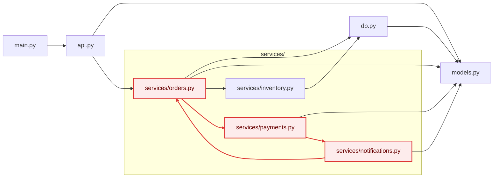

# S4b Mermaid 다이어그램 스킬 — 코드에서 그림을 뽑고 설명한다

> 구성: 스킬(SKILL.md + scripts/) + 샘플 앱 | 난이도: ★★☆ | 필요: opencode 1.19.5, Python 3.10+ | 슬라이드: 스킬 — 산출물을 만드는 스킬

## 무엇을 보여 주나

`scan_structure.py` 가 파이썬 프로젝트의 소스를 **실행하지 않고 `ast` 로 읽어** 모듈 간 import 관계를 뽑아 Mermaid 순서도와 디렉터리 트리를 Markdown 파일로 만든다.
모델은 이 결과를 보고 아키텍처를 설명하고 **순환 import** 를 찾아 끊는 방법을 제안한다. 그림은 스크립트가, 해석은 모델이 맡는다.
`sample-app/` 에는 순환 import 가 하나 심어져 있다.

## 실무에서는

- 처음 보는 코드베이스에서 "어떤 모듈이 어디에 의존하나"를 빠르게 파악할 때(온보딩, 인수인계)
- 리팩터링 전에 순환 의존과 과하게 import 되는 모듈(`models.py` 같은 공용 기반)을 찾을 때
- PR 설명이나 문서에 최신 구조도를 코드와 같은 저장소에 Markdown 으로 남길 때(손으로 그린 그림은 금방 낡는다)

## 파일 구성

```
s4b-mermaid-diagram/
├── README.md
├── fake_llm.py                                     # 가짜 모델 서버(m8 예제의 복사본): 실제 모델 없이 스킬 로드 → 스크립트 실행을 검증
├── check.py                                        # 자동 검증 (그래프 문법 구조, 순환 탐지, lazy import 등)
├── sample-app/                                     # 분석 대상 샘플 (8개 모듈, 직접 실행도 된다)
│   ├── main.py → api.py → services/orders.py
│   ├── models.py, db.py
│   └── services/{inventory,orders,payments,notifications}.py   # orders → payments → notifications → orders (순환)
├── out/architecture.md                             # 생성 결과 (gitignored)
└── .opencode/skills/mermaid-diagram/
    ├── SKILL.md                                    # 실행 명령, 설명 형식, 그림 보는 법 안내
    └── scripts/scan_structure.py                   # ast → 그래프 → 순환 탐지(Tarjan) → Mermaid + 트리
```

## 따라 하기

1. (선택) 스크립트를 먼저 직접 실행해 본다.

   PowerShell:
   ```powershell
   cd examples\01-skills\s4b-mermaid-diagram
   python .opencode\skills\mermaid-diagram\scripts\scan_structure.py sample-app --out out\architecture.md
   ```
   Linux bash:
   ```bash
   cd examples/01-skills/s4b-mermaid-diagram
   python3 .opencode/skills/mermaid-diagram/scripts/scan_structure.py sample-app --out out/architecture.md
   ```

2. 이 폴더에서 opencode 를 실행한다. 평소 쓰는 모델로 실행하면 됩니다.
   (모델 설정이 없다면 `opencode run -m opencode/big-pickle --auto "<프롬프트>"` 처럼 무료 모델을 쓸 수 있다.)
   ```
   opencode
   ```
   입력할 프롬프트:
   ```
   mermaid-diagram 스킬로 sample-app 의 아키텍처를 다이어그램으로 만들고 구조를 설명해 줘. 순환 import 가 있으면 알려 줘.
   ```

3. `out/architecture.md` 를 열어 그림을 본다(아래 "그림 보는 법").

## 그림 보는 법 (Mermaid 렌더링)

- **GitHub**: 저장소에 올린 `.md` 파일 안의 ` ```mermaid ` 블록은 웹에서 자동으로 그려진다. (이 저장소를 GitHub 에서 열어도 된다)
- **VS Code**: Mermaid 를 지원하는 확장(예: "Markdown Preview Mermaid Support")을 설치하고 `out/architecture.md` 를 열어 Markdown 미리보기(`Ctrl+Shift+V`)를 연다. 확장 없이는 코드 블록으로만 보인다.
- **인터넷이 막힌 환경**:
  - 확장(`.vsix`)이나 `@mermaid-js/mermaid-cli`(`mmdc`)를 패키지 미러로 설치해 PNG/SVG 로 변환한다: `mmdc -i diagram.mmd -o diagram.svg` (Mermaid 블록만 `.mmd` 로 저장해서 입력)
  - 그것도 어렵다면 Mermaid 코드는 그냥 텍스트이므로 `out/architecture.md` 의 "Modules" 표와 "Directory tree", "Import cycles" 절만으로도 구조를 읽을 수 있다.
- 순환에 속한 모듈·화살표는 붉게 표시되고, 함수 안 import 는 점선 화살표로 그려진다.

## 기대 결과

스크립트를 직접 실행해 만들어진 `out/architecture.md` 의 일부다(Mermaid 문법은 mermaid 파서로 확인했다).

````markdown
# Architecture of `sample-app`

8 modules, 13 import edges between them, 1 import cycle(s).
Solid arrow = import at module level, dotted arrow = import inside a function. Red = part of a cycle.

## Module import graph



## Directory tree

```text
sample-app/
├── services/
│   ├── __init__.py  (0 lines)
│   ├── inventory.py  (6 lines)
│   ├── notifications.py  (8 lines)
│   ├── orders.py  (16 lines)
│   └── payments.py  (8 lines)
├── api.py  (8 lines)
├── db.py  (14 lines)
├── main.py  (10 lines)
└── models.py  (10 lines)
```

## Import cycles

- `services/notifications.py -> services/orders.py -> services/payments.py -> services/notifications.py`
````

순환은 `services/orders.py → services/payments.py → services/notifications.py → services/orders.py` 하나이고, `models.py` 는 5개 모듈이 import 하는 공용 기반이다. 모델은 이를 바탕으로 "`find_order_email` 을 `models.py` 나 별도 모듈로 옮겨 `notifications` 가 `orders` 를 import 하지 않게 한다" 같은 해결책을 제안하게 된다.

> 모델 확인 상태: 이 예제의 **실제 모델 실행은 확인하지 못했다**(무료 모델 한도 소진). 위 출력은 모델 없이 스크립트를 직접 실행한 결과이고, 모델은 이 결과를 받아 SKILL.md 의 보고 형식대로 한국어 답변을 쓰게 된다. `check.py` 는 가짜 모델로 "skill 도구 → bash 도구로 스크립트 실행" 흐름이 Linux 와 Windows 에서 동작함을 검증한다.


## 동작 원리

1. 스킬 로드 후 모델은 `Base directory for this skill` + `scripts/scan_structure.py sample-app --out out/architecture.md` 를 프로젝트 루트에서 실행한다. 분석 대상(`sample-app`)과 출력 경로는 프로젝트 기준 경로다.
2. 스크립트는 `.py` 파일을 모듈 이름(`services.orders`)으로 바꾸고, `import x`, `from x import y`, 상대 import(`from . import b`)를 해석해 **프로젝트 안 모듈끼리의 간선**만 남긴다. 표준 라이브러리·외부 패키지는 무시한다. 함수 안의 import 는 `lazy` 로 표시한다.
3. 강연결 요소(Tarjan 알고리즘)로 순환을 찾고 각 순환의 최단 경로 하나를 `a -> b -> c -> a` 로 기록한다.
4. Mermaid `flowchart LR` 를 만들 때 패키지는 `subgraph`, 순환 노드는 `classDef`, 순환 간선은 `linkStyle` 로 색을 입힌다. 같은 내용을 JSON 으로도 stdout 에 내보내 모델이 읽는다.
5. 모델은 JSON 의 `cycles`·`most_imported`·`entry_points` 를 근거로 설명하고, 필요하면 순환에 포함된 3개 파일만 읽어 끊는 방법을 이 코드의 이름으로 제안한다.

## 직접 바꿔 보기

1. `services/notifications.py` 의 `from services import orders` 를 `send_receipt` 함수 안으로 옮기고 다시 실행한다. 순환은 그대로 보고되지만 화살표가 점선(lazy)으로 바뀐다. "함수 안에서 늦게 import" 로 끊는 방법이 어떤 모양인지 확인한다.
2. `find_order_email` 을 `models.py` 로 옮기고 `notifications.py` 가 `orders` 를 import 하지 않게 고친 뒤 재실행한다. `Import cycles` 가 `None found.` 가 된다.
3. 자기 프로젝트의 패키지 폴더를 인자로 줘 본다: `python scan_structure.py <폴더> --out out/mine.md`.

## 주의할 점 / 문제 해결

- **분석은 정적이다.** `importlib.import_module("...")` 같은 동적 import, 조건부 import 는 보이지 않거나 항상 있는 것처럼 보인다. SKILL.md 가 한계를 밝히도록 지시한다.
- **문법 오류가 있는 파일**이 있으면 종료 코드 2 와 `error: cannot parse 파일:줄` 이 나온다.
- 큰 프로젝트에서는 그래프가 복잡해진다. 하위 패키지 폴더 하나만 인자로 주면 된다.
- **Windows 에서는 `python`, Linux 에서는 `python3`**: SKILL.md 는 `python` 으로 안내하고 "없으면 `python3`" 를 덧붙였다. Windows 에서 opencode 의 `bash` 도구는 Git Bash 가 아니라 **Windows PowerShell 5.1** 에서 명령을 실행한다. 그래서 SKILL.md 는 `&&`, `export`, `$변수`, `| head` 같은 bash 전용 문법 없이 `python <스킬 폴더>/scripts/… 인자` **한 줄**만 시킨다. 스킬 폴더 경로는 Windows 에서 `C:\...\.opencode\skills\<이름>` 처럼 역슬래시로 오지만, 파이썬에는 `/` 로 바꿔 넘겨도 동작한다(`check.py` 가 가짜 모델로 검증). 출력 Markdown 의 경로 표기는 항상 `/` 이다(Windows 에서도).
- 트리는 `├──` 같은 유니코드 선을 쓴다. 파일은 UTF-8 로 쓰고, 터미널 글꼴이 깨지면 에디터로 연다.
- `out/` 은 gitignore 대상이다. 첫 실행 지연(`.opencode/` 의 `@opencode-ai/plugin` 자동 설치 시도)은 S3a 와 같다. 이 예제에도 플러그인이 없어 레지스트리에 닿지 않아도 눈에 띄는 멈춤은 없었다. 자세한 내용은 [P6 README](../../03-plugins/p6-custom-tool/README.md#npm-자동-설치와-레지스트리패키지-미러) 참고.
